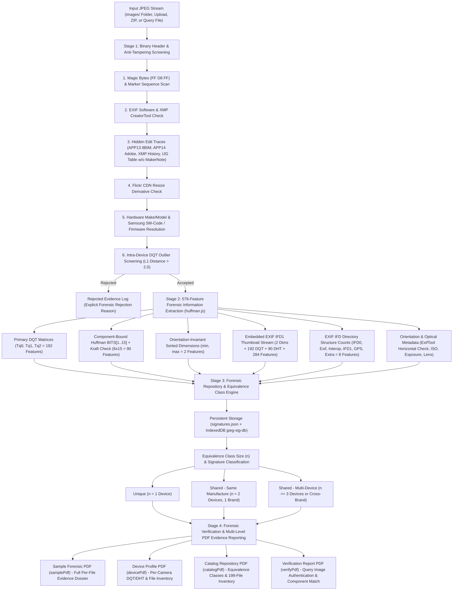

# JPEG Signature Analyzer & Database

A **100% Client-Side** multimedia forensics web application (HTML5, Vanilla JavaScript, CSS3) designed to analyze, classify, and identify camera device models from JPEG images through the extraction of Quantization Tables (DQT $8 \times 8$), compression structures (SOF, DHT, DRI), and EXIF metadata.

The application runs entirely in the user's browser memory and can be hosted statically on **GitHub Pages** without any backend server, external database, third-party API, or web scraping.

---

## 📷 Dataset Credits & Attribution

The default sample dataset (`images/`) utilized in this repository and research is sourced from:

- **Data Owner & Copyright Holder:** **Mandatos PT Francisco Beltrão**
- **Flickr Profile:** [https://www.flickr.com/photos/202288615@N07](https://www.flickr.com/photos/202288615@N07)
- **Flickr Collections / Albums Used:**
  1. `1-conferncia-municipal-do` — *1ª Conferência Municipal do Esporte (07/10/2026)*
  2. `encontro-conselhos` — *Encontro de Conselhos Tutelares (29/10/2026)*
  3. `manifestao-na-copel-francisco` — *Manifestação na Copel Francisco Beltrão (06/03/2025)*
  4. `visita-na-ocupao` — *Visita na Ocupação do São Francisco (23/09/2026)*
- **Usage Purpose:** Academic research, compression analysis, and multimedia forensics education for the **Master of Cyber Security (S2)** program.
- **Copyright Statement:** All original image copyrights remain exclusively with the creator and account owner on Flickr. Sincere appreciation to *Mandatos PT Francisco Beltrão* for making high-quality photographic data publicly accessible for multimedia forensic research.

### Dataset Breakdown & Forensic Curation (`images/`)

The bundled dataset comprises **204 original photographic files** across 4 collections, automatically curated by `tools/build-signatures.js`:

| Collection Folder (`images/`) | Raw Files | Accepted Samples | Rejected Samples | Detected Camera Models |
| :--- | :---: | :---: | :---: | :--- |
| `1-conferncia-municipal-do` | 9 | **9** | 0 | *Sony ZV-E10M2* (4), *Apple iPhone 13* (5) |
| `encontro-conselhos` | 96 | **91** | 5 | *Apple iPhone 16 Pro* (90), *Apple iPhone 14 Pro* (1) |
| `manifestao-na-copel-francisco` | 43 | **43** | 0 | *Apple iPhone 14 Pro* (38), *Apple iPhone 15 Pro Max* (5) |
| `visita-na-ocupao` | 56 | **55** | 1 | *Samsung Galaxy S24 FE* (55) |
| **Total** | **204** | **198** | **6** | **6 Camera Models (3 Manufacturers: Apple, Samsung, Sony)** |

- **Orientation Coverage:** **159 Landscape** samples (`ExifTool Description: Horizontal (normal)`) and **39 Portrait** samples (`Rotate 90 CW` and `Rotate 270 CW`).
- **Quantization Behavior Coverage:** Covers both **fixed per-model quantization tables** (*Apple iPhone* series, *Sony ZV-E10M2*) and **dynamic/scene-adaptive quantization tables** (*Samsung Galaxy S24 FE*, which produces 32 distinct DQT tables across 55 captures).
- **Ground-Truth Rejection Summary:** 6 files are automatically excluded during curation (5 files lacking EXIF `Make`/`Model` ground-truth tags and 1 `1080×2340` screen-resolution image lacking a hardware `MakerNote`).

---

## 🗄️ Forensic Database Management Design

Because the platform operates **100% client-side** (zero backend dependencies for static GitHub Pages deployment), the forensic repository uses a **3-Layer Hybrid Storage Architecture** managed in `app.js`:

### 1. Three-Layer Storage Architecture
1. **Master Static Baseline (`signatures.json` & `dataset.js`):**
   - Pre-built reference catalog generated by `tools/build-signatures.js` and loaded into `window.DEFAULT_SIGNATURES`.
2. **Client-Side Persistent Object Store (`IndexedDB` — `jpeg-sig-db`):**
   - Browser-native transactional database (`DB` wrapper in `app.js`) with object store `samples` (`keyPath: 'id'`).
   - Persists all 198 baseline samples alongside any new camera samples ingested by the investigator or registered from the Verification tab.
3. **In-Memory Analytical Index (`samples[]` & `groupSignatures()`):**
   - Real-time indexing in memory by normalized device name (`device`), 64-bit DQT hash (`dqtKey`), and 64-bit full 576-feature hash (`fullKey`).

### 2. Forensic Sample Schema (`samples` Object Store)
Each accepted image is stored as a self-contained JSON evidence record using a **Composite Primary Key** `id = "${file}|${size}|${dqtKey}"` to guarantee deterministic deduplication:

| Attribute Group | Database Fields | Forensic Purpose |
| :--- | :--- | :--- |
| **Evidence Identity** | `id`, `file`, `size`, `format`, `bundled` | Composite primary key, relative file path, byte length, format validation, and baseline flag. |
| **Normalized Device Identity** | `make`, `model`, `rawModel`, `device`, `software` | Canonical manufacturer (`APPLE`, `SAMSUNG`, `SONY`), resolved model name (e.g., `SM-N985F` $\rightarrow$ `Galaxy Note20 Ultra (SM-N985F)`), raw EXIF model code, and firmware string. |
| **Geometry & Orientation** | `width`, `height`, `displayWidth`, `displayHeight`, `orientationNum`, `orientationExifTool`, `isPortrait` | Native sensor dimensions (`SOF`) vs. upright display dimensions governed by `ExifTool Description` (`Horizontal (normal)`, `Rotate 90 CW`, `Rotate 270 CW`). |
| **Primary Compression Parameters** | `dqtKey`, `dqt`, `dht`, `dhtHash`, `huff`, `jpegType`, `subsampling`, `precision`, `dri`, `markers` | $8 \times 8$ Quantization matrices ($T_{q0}, T_{q1}$), 90 Huffman code-length counts (`BITS[1..15]`), chroma subsampling (`4:2:0` / `4:2:2`), and ordered marker sequence. |
| **EXIF Structure & Thumbnail** | `exifStruct` (8 values), `thumbSig` (284 values), `exif`, `thumb` | Entry counts across 5 standard IFDs + extra IFDs, embedded `IFD1` thumbnail compression vector, shooting parameters, and EXIF-stripped upright RGB preview. |
| **576-Feature Signature Hash** | `fullKey` | 64-bit FNV-1a hash of the complete 576-feature camera signature vector (`fullKeyOf()`). |

---

## 🧮 Quantization Table (`DQT`) Extraction & Mathematical Model

The **Define Quantization Table (`0xFFDB`)** segment is the primary hardware/firmware fingerprint of a JPEG encoder, as camera manufacturers design proprietary $8 \times 8$ DCT frequency divisors to balance visual sharpness against bitstream size.

### 1. Binary Extraction & Zig-Zag De-Permutation (`huffman.js`)
- **Marker `0xFFDB` Parsing (`parseJpeg()`):** Each DQT table begins with a `Pq/Tq` byte where the upper nibble `Pq` specifies precision (`0` = 8-bit / 64 bytes, `1` = 16-bit / 128 bytes) and the lower nibble `Tq` $\in \{0, 1, 2, 3\}$ identifies the destination table ($T_{q0}$ = Luminance $Y$, $T_{q1}$ = Chrominance $C_b, C_r$).
- **Zig-Zag (`ZZ`) to Natural $8 \times 8$ Matrix Order:** JPEG stores the 64 quantization steps in zig-zag scan order from the DC coefficient $(0,0)$ to the highest-frequency AC coefficient $(7,7)$. The parser remaps each zig-zag index $i \in [0..63]$ into natural row-major order via `ZZ[i]`:
  $$\text{DQT}_{\text{natural}}[\text{ZZ}[i]] = \text{byte}[i]$$

### 2. Inter-Table Distance & Similarity Metric (`dqtDist()` & `simPct()`)
To compare two quantization signatures $A$ and $B$ (and detect scene-adaptive quantization families within the same device), the analyzer computes the mean $L_1$ step difference across shared tables $T$:
$$D(A, B) = \frac{1}{64 \cdot |T|} \sum_{t \in T} \sum_{i=0}^{63} \left| A_t[i] - B_t[i] \right|, \qquad \text{Similarity}(D) = \frac{100}{1 + D}\%$$
- $D(A, B) = 0$: **Exact match** (identical 64-bit `dqtKey`).
- $0 < D(A, B) \le 1.0$ (`NEAR`): **Adaptive quantization variant** (grouped only when both tables originate from the same device model).
- $D(A, B) > 2.0$ (`CLOSE`): **Distinct / Outlier compression profile**.

### 3. IJG Annex K Standard Table & Quality Factor Estimation (`scaleQ()` & `ijgMatch()`)
Software encoders based on `libjpeg` generate quantization tables by scaling the ITU-T T.81 Annex K reference matrices ($T_{\text{std}}$) for quality factor $Q \in [1..100]$:
$$S(Q) = \begin{cases} \lfloor 5000 / Q \rfloor & \text{if } Q < 50 \\ 200 - 2Q & \text{if } Q \ge 50 \end{cases}, \qquad T_Q[i] = \text{clamp}\!\left(\left\lfloor \frac{T_{\text{std}}[i] \cdot S(Q) + 50}{100} \right\rfloor, 1, 255\right)$$
An exact match to $T_Q$ on an image lacking a hardware `MakerNote` (`0x927C`) is flagged as a third-party `libjpeg` re-encoding trace.

---

## 🔬 Forensic Design, Information Flow & End-to-End Methodology

The forensic architecture follows the methodology of ***Digital Image Authentication from JPEG Headers*** (*Kee, Johnson & Farid, IEEE Transactions on Information Forensics and Security, 2011*) across an end-to-end pipeline from raw binary header parsing to downloadable PDF forensic evidence reports:



### Detailed Forensic Information Flow (Step-by-Step)

1. **Stage 1 — Binary Acquisition & 6-Layer Anti-Tampering Screening (`analyze()` & `editTraces()`):**
   - **Binary Stream Inspection:** Reads raw JPEG segments (`SOI`, `APP0`–`APP15`, `DQT`, `SOF0`/`SOF2`, `DHT`, `DRI`, `SOS`) directly via `DataView` without re-decoding pixel data.
   - **Tampering & Re-encoding Detection:** Filters out edited or re-compressed images using both explicit metadata (`Software` / `CreatorTool`) and **metadata-independent binary traces** (`APP13 Photoshop 3.0 / 8BIM`, `APP14 Adobe`, `xmpMM:History` / `stEvt:action`, exact ITU-T T.81 IJG Annex K standard tables lacking a hardware `MakerNote`, and Flickr CDN resized dimensions).
   - **Device & Firmware Normalization (`resolveDeviceMeta()`):** Normalizes manufacturer aliases and resolves hardware model codes and baseband firmware strings (e.g., `Make: SAMSUNG`, `Model: SM-N985F`, `Software: N985FXXSIHYH3` $\rightarrow$ **`Samsung Galaxy Note20 Ultra (SM-N985F)`**).

2. **Stage 2 — 576-Feature Forensic Information Extraction (`huffman.js`):**
   - **Primary Compression Matrix (192 Features):** De-zig-zags Luminance ($T_{q0}$) and Chrominance ($T_{q1}, T_{q2}$) $8 \times 8$ quantization tables (`dqt192()`), computes 64-bit FNV-1a hash (`dqtKey`), and estimates the IJG quality factor ($Q$).
   - **Huffman Entropy Distribution (90 Features):** Maps `SOS` component selectors (`Td`/`Ta`) to `Y-DC`, `Y-AC`, `Cb-DC`, `Cb-AC`, `Cr-DC`, and `Cr-AC`, extracts code-length counts `BITS[1..15]`, generates canonical Huffman codes (ITU-T T.81 Annex C), and validates Kraft's inequality ($\sum_{L=1}^{15} \text{BITS}[L]\cdot 2^{-L} \le 1$).
   - **Sensor Geometry & `ExifTool` Orientation (2 Features + Display Metadata):** Extracts sorted native sensor dimensions $(\min(w,h), \max(w,h))$ and evaluates **`ExifTool Description`** (`Horizontal (normal)` $\rightarrow$ **Landscape** `4:3`; `Rotate 90 CW` / `Rotate 270 CW` $\rightarrow$ **Portrait** `3:4`).
   - **Embedded Thumbnail Forensics (284 Features):** Locates the secondary JPEG stream inside EXIF `IFD1` (`0x0201` offset, `0x0202` length) and extracts its dimensions (2), DQT matrices (192), and Huffman `BITS[1..15]` counts (90).
   - **EXIF Directory Topology (8 Features):** Counts raw directory entries across `IFD0`, `Exif SubIFD`, `Interoperability IFD`, `IFD1`, `GPS IFD`, extra IFD count, extra IFD entries, and parser errors (`exifStruct()`).

3. **Stage 3 — Equivalence Class Analysis & Repository Classification (`groupSignatures()` & `eqStats()`):**
   - Groups identical compression signatures and clusters scene-adaptive DQT variants ($D(A,B) \le 1.0$) strictly within the same camera model (`sameDevs`).
   - Evaluates **Equivalence Class Size ($n$)** across DQT-only (192), DQT + Huffman (282), and Full Signature (576) feature sets, classifying every signature into **Unique** ($n=1$), **Shared (Same Manufacture)** ($n=2$, single brand), or **Shared (Multi-Device)** ($n \ge 3$ or cross-brand).

4. **Stage 4 — Forensic PDF Evidence Extraction & Reporting (`samplePdf`, `devicePdf`, `catalogPdf`, `verifyPdf`):**
   - Every file and device in the repository can be exported directly to a structured **Forensic PDF Report**:

| PDF Report Type | Trigger Location in UI | Extracted Forensic Information Included in PDF |
| :--- | :--- | :--- |
| **1. Sample Forensic Report (`samplePdf`)** | • **Photo Gallery** card (`Download Forensic PDF`)<br>• **Sample Detail Modal** (`Download Sample Forensic PDF`)<br>• **Catalog Device Table** (`PDF` button per row)<br>• **Ingestion Table** (`PDF` button per accepted row) | Upright preview image, File & Folder path, Byte size, Make, Resolved Model & EXIF Model Code, Firmware, `ExifTool Description` & Horizontal check, Display vs. Native Sensor dimensions, `dqtKey` (192) & `fullKey` (576), Equivalence Class category, Thumbnail status (284), EXIF IFD counts (8), all EXIF optical tags (ISO, Exposure, F-Number, Focal Length, Lens, Timestamp), full $8 \times 8$ DQT matrices ($T_{q0}, T_{q1}$), and 6-table Huffman `BITS[1..15]` + canonical codes. |
| **2. Device Profile Report (`devicePdf`)** | • **Catalog Tab** (`Download Device Samples PDF` when viewing a device) | Aggregated device profile, distinct DQT & 576-feature signature counts, all $8 \times 8$ DQT matrices and Huffman `BITS[1..15]` profiles for that camera model, and the complete per-file inventory of all samples belonging to that device. |
| **3. Repository Catalog Report (`catalogPdf`)** | • **Repository Tab** (`Download Catalog PDF`) | Global repository summary, formal **Equivalence Class Analysis** table ($n=1..5+$, median $n$, max $n$, uniquely identified devices), extraction methodology, signature classification lists (`Unique`, `Shared`), and the complete 198-file repository inventory. |
| **4. Single-Image Verification Report (`verifyPdf`)** | • **Verification Tab** (`Download PDF Report`) | Forensic authentication verdict (`MATCH`, `AUTHENTIC ENCODER FAMILY`, or `MISMATCH / EDIT TRACES`), component-by-component 576-feature comparison against catalog devices, DQT distance ranking, native resolution check, IJG/APP13/APP14/XMP tamper check, Huffman canonical codes, and $8 \times 8$ DQT matrices. |

---

## 🌟 Core Features

### 1. Local Ingestion & Multi-Stage Filtering
- Supports simultaneous sample acquisition via:
  - Multiple file selection
  - Folder upload (`webkitdirectory`)
  - Direct browser `.zip` archive extraction using JSZip
- **Automatic 3-Stage Filtering Pipeline:**
  1. **Binary JPEG Validation:** Verifies the `FF D8 FF` SOI header. Non-JPEG formats (PNG, WEBP, GIF, etc.) are accurately identified and flagged.
  2. **Third-Party Editor Elimination:** Automatically detects and rejects images processed or modified by software editors (e.g., Photoshop, GIMP, Lightroom, Snapseed, Canva).
  3. **Device Metadata Verification:** Ensures camera hardware labels (`Make` & `Model`) are present in EXIF.

### 2. Photo Gallery & Smart Orientation
- Visual catalog of all repository samples with adaptive aspect ratios:
  - **Landscape:** Displays naturally wide (4:3 / 16:9).
  - **Portrait:** Displays naturally vertical and upright (3:4 / 9:16).
- **TIFF/EXIF Forensic Orientation Standard:**
  - Value 1 (Top-Left): *Landscape (Normal)*
  - Value 3 (Bottom-Right): *Landscape (Rotate 180°)*
  - Value 6 (Right-Top): *Portrait (Camera rotated 90° CW)*
  - Value 8 (Left-Bottom): *Portrait (Camera rotated 270° CW)*
- Real-time filtering by search text, device model, dataset folder, and orientation category (*All*, *Portrait*, *Landscape*).

### 3. Forensic Extraction & DQT Heatmaps
- Binary parsing of $8 \times 8$ Quantization Tables (Luminance Tq0 and Chrominance Tq1) using native JavaScript `DataView`.
- Interactive color-intensity heatmap matrix visualization.
- IJG Quality Factor estimation ($\approx Q$).
- Full camera parameter extraction (ISO, Exposure Time, Focal Length, F-Number, Lens Model, etc.).

### 4. Signature Classification Engine
- Groups collected camera compression signatures into 3 forensic categories:
  - **Unique:** Signature exclusive to 1 specific device model.
  - **Shared (Same Manufacture):** Signature shared between 2 models from the same manufacturer.
  - **Shared (Multi-Device):** Signature shared across 3+ distinct devices.
- DQT distance metric clustering to unify adaptive quantization tables (such as Samsung dynamic camera profiles).

### 5. Single Image Forensic Verification
- Matches a target query image against the active signature repository.
- Forensic outcome indicators:
  - **MATCH:** DQT signature is consistent with the claimed EXIF device.
  - **MISMATCH ALERT:** Claimed camera metadata conflicts with compression table characteristics (indicates metadata spoofing or re-compression).
  - **EDITOR WARNING:** Detected traces of photo editing applications.
- One-click export of forensic verification reports to **PDF** format.

### 6. Client-Side Repository Management
- Persistent browser storage powered by **IndexedDB**.
- Full dataset **Export** and **Import** functionality in standard `.json` format (`signatures.json`).
- Pre-bundled with 198 camera samples ready for instant offline analysis upon page load.

---

## 🧬 Full Signature Vector (576 features)

The reference method is *Digital Image Authentication from JPEG Headers* (Kee, Johnson & Farid, IEEE TIFS 2011). A camera signature is not only the quantization table; it is the following 576-value vector, extracted in `huffman.js` (`parseJpeg`, `huffSets`, `exifStruct`, `thumbSigOf`, `sigParts`):

| Component | Values | How it is obtained |
|---|---|---|
| Quantization tables Tq0–Tq2 | 3 × 64 = **192** | DQT segments, un-zig-zagged to natural order; missing tables are zero |
| Huffman code lengths | 6 × 15 = **90** | DHT `BITS[1..15]` of Y-DC, Y-AC, Cb-DC, Cb-AC, Cr-DC, Cr-AC |
| Image dimensions | **2** | `(min(w,h), max(w,h))`, so portrait and landscape give the same values |
| Embedded thumbnail | 2 + 192 + 90 = **284** | IFD1 tags `0x0201`/`0x0202` locate the thumbnail JPEG, parsed with the same code (dimensions, DQT, Huffman) |
| EXIF structure | **8** | Entry counts of IFD0, Exif, Interoperability, IFD1, GPS; number of extra IFDs; entries in extra IFDs; parser errors |
| **Total** | **576** | The full-signature ID (`fullKey`) is a 64-bit hash of this vector |

### How the Huffman features are computed

A DHT segment holds, for each table, a `Tc/Th` byte (class 0 = DC, 1 = AC, plus table id), `BITS[1..16]` and `HUFFVAL`. `BITS[L]` is the number of Huffman codes whose length is `L` bits; `HUFFVAL` lists the symbols in code order.

1. The parser reads every DHT and stores `BITS[1..16]` per table.
2. The SOS segment tells which DC table (`Td`) and AC table (`Ta`) each component uses, so the six tables are taken **per component** (Y, Cb, Cr), not in file order.
3. Feature `f[t][L] = BITS_t[L]` for `L = 1..15`, giving 6 × 15 = 90 values.
4. Integrity check using canonical code assignment (JPEG Annex C): start with `code = 0`; for each length `L` the first code is `code`, then `code = (code + BITS[L]) << 1`. The table is valid only if `code` never exceeds `2^L` (Kraft inequality). The first code of each length is shown in the PDF report.

Worked example (Y-DC table of an iPhone sample): `BITS = 0 1 5 1 1 1 1 1 1 0 0 0 0 0 0` means no 1-bit code, one 2-bit code (`00`), five 3-bit codes (`010`–`110`), then one code each for lengths 4–9; 12 symbols in total.

### Equivalence class analysis

A class is the set of devices (Make + Model) that share one signature; its size is `n`. The Classification tab and the catalog PDF report, for three feature sets (DQT only, DQT + Huffman, full 576): number of classes, distribution `n = 1, 2, 3, 4, ≥ 5`, median and maximum `n`, and the number of devices identified uniquely. On the bundled dataset (198 samples across 6 devices):

| Feature set | Classes | n=1 | n=2 | n=3 | Median n | Max n | Devices uniquely identified |
|---|---|---|---|---|---|---|---|
| DQT only (192) | 37 | 35 | 1 | 1 | 1 | 3 | 3 / 6 |
| DQT + Huffman (282) | 41 | 39 | 1 | 1 | 1 | 3 | 3 / 6 |
| Full signature (576) | 56 | 55 | 1 | 0 | 1 | 2 | 4 / 6 |

Adding Huffman tables expands the signature classes from 37 to 41, while adding resolution, thumbnail, and EXIF directory structure expands them to 56 classes and reduces the largest shared Apple iPhone equivalence class from `n = 3` to `n = 2`.

### Dataset filtering (robustness)

Each file passes these checks in order; the first failing check gives the rejection reason shown in the Ingestion table.

| # | Check | What it catches |
|---|---|---|
| 1 | JPEG header `FF D8 FF` and at least one DQT table | Non-JPEG files |
| 2 | **Software tag / XMP `CreatorTool`** matches a known editor | Photoshop, GIMP, Lightroom, Snapseed, Canva, … |
| 3 | **Editing traces without a Software tag** | APP13 `Photoshop 3.0` (8BIM) or APP14 `Adobe` marker; XMP edit history (`xmpMM:History`, `stEvt:action`); quantization tables **exactly equal to the IJG standard tables** (Q1–100) |
| 4 | **Flickr resize derivatives**: long side 75, 100, 150, 240, 320, 500, 640, 800, 1024, 1600 or 2048 px | Re-compressed copies with Flickr's own tables |
| 5 | EXIF `Make` and `Model` present | Ground truth for the device label |
| 6 | **Signature outlier** (after analysis, against the catalog): if the device already has at least 3 samples, the new DQT must be within a mean step difference of 2.0 of one of them | Re-encoded files or a wrong Make/Model. Samples of one camera cluster tightly (Samsung variants differ by ≤ 0.02), so a large distance is suspicious. New devices are not screened |

None of the 198 camera files in the bundled dataset trigger checks 3 or 4. Check 3 was also tested with synthetic files carrying a Photoshop APP13 block, an Adobe APP14 marker, XMP history and an XMP `CreatorTool`; all were rejected while the unmodified original was accepted.

Verification also reports the same editing traces, plus a **native resolution check**: the image's `(min, max)` size is compared with sizes seen in the catalog for the claimed device.

### Known limitations

- Adobe Photoshop reference tables (versions 3–CS5, all quality levels) are **not bundled**; only the IJG baseline is. A Photoshop file that carries no APP13/XMP traces and no Software tag is therefore not caught by check 3. Add reference tables to `SOFTWARE_BASELINES` in `huffman.js` to extend detection.
- Double JPEG compression (periodic artifacts in the DCT histogram) is not analysed.
- The traces are heuristics: a clean re-save by an unknown encoder can still pass, so they reduce but do not eliminate edited files.
- The paper keeps only (Make, Model, Signature) configurations with at least 25 images. This is **reported, not enforced**, because the bundled dataset (198 samples) would otherwise be emptied.
- Only the first scan's Huffman tables are read, so progressive JPEGs that redefine tables between scans are summarised by the first scan.
- Samples without an EXIF thumbnail (27 in the bundled data) get zeros for the 284 thumbnail features, as in the paper.

---

## 🎨 UI & Design Principles
- **Dark Mode with Navy Blue Accents**.
- **Solid Colors Only:** Zero transparent or translucent elements (`rgba`, `transparent`, `opacity`) for maximum visual contrast and legibility.
- **Mobile-First Responsive Layout:** Bottom touch-bar navigation for mobile screens, flexible tablet grids, and desktop layouts.

---

## 🚀 Running Locally

Serve the repository root using any static web server:

```bash
# Using Python 3:
python3 -m http.server 8000

# Or using Node.js:
npx serve .
```

Open `http://localhost:8000` in your web browser.

### Automatic Sync When Adding New Folders to `images/`
- **Browser Auto-Discovery (Local Server):** When served via `python3 -m http.server` or `npx serve`, `autoDiscoverImagesFolder()` in `app.js` automatically scans `images/` on page load and ingests any newly added `.jpg` files.
- **Background File Watcher:** Run `node tools/watch-images.js` to watch `images/` and automatically rebuild `signatures.json` and `dataset.js` whenever files/folders are added or modified.
- **Git Pre-Commit Hook:** `.git/hooks/pre-commit` automatically runs `node tools/build-signatures.js` whenever changes under `images/` are staged for commit.

---

## 🌐 Deployment to GitHub Pages

1. Commit and push changes to GitHub:
   ```bash
   git add .
   git commit -m "feat: complete JPEG forensic analyzer with English documentation"
   git push origin main
   ```
2. In your GitHub repository, navigate to **Settings** &rarr; **Pages**.
3. Under **Build and deployment** &rarr; **Source**, select **Deploy from a branch**.
4. Choose the **main** branch and **/(root)** folder, then click **Save**.
5. Your application will be live at `https://<username>.github.io/<repo-name>/`.

---

## 📄 License

This project is licensed under the **GNU General Public License v3.0 (GPL-3.0)** — see the [LICENSE](LICENSE) file for full details.
Copyright (C) 2026 **Arief Yusuf Winata**.
